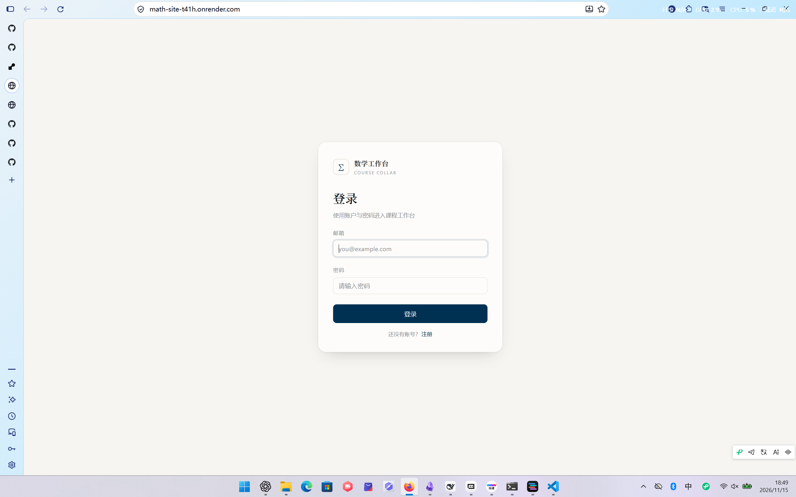
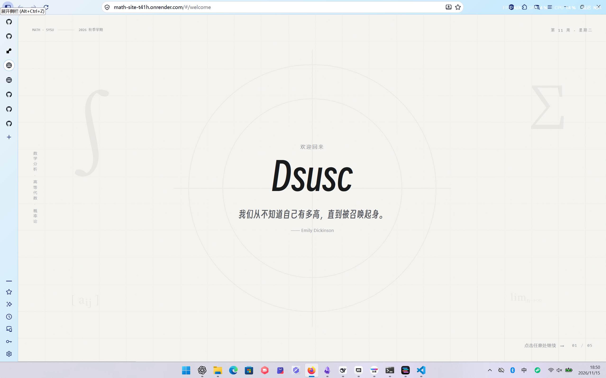
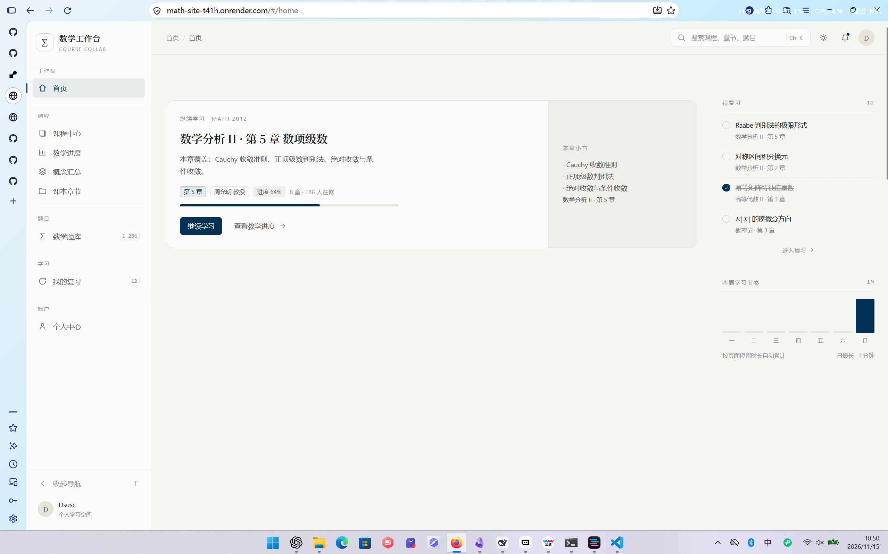
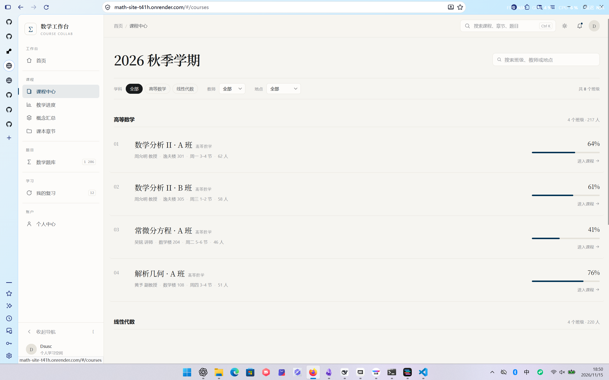
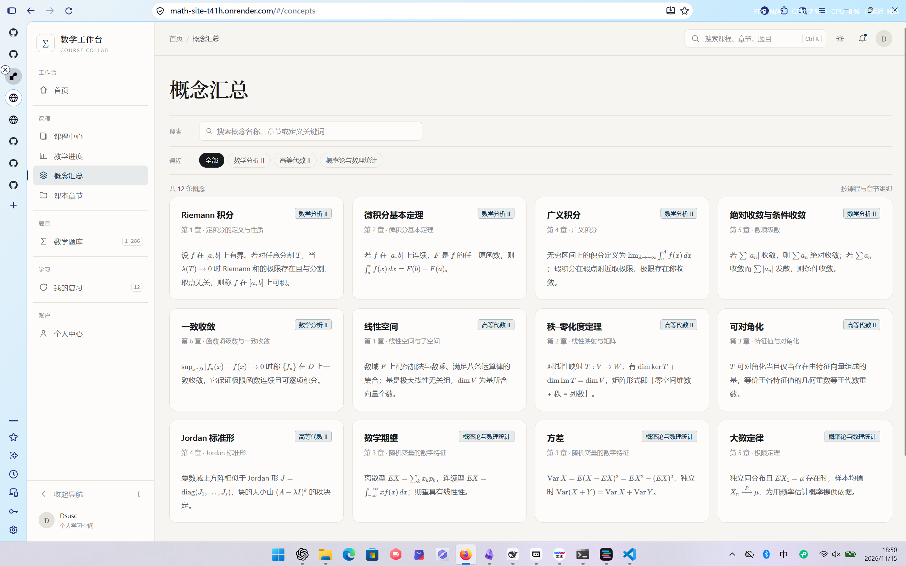
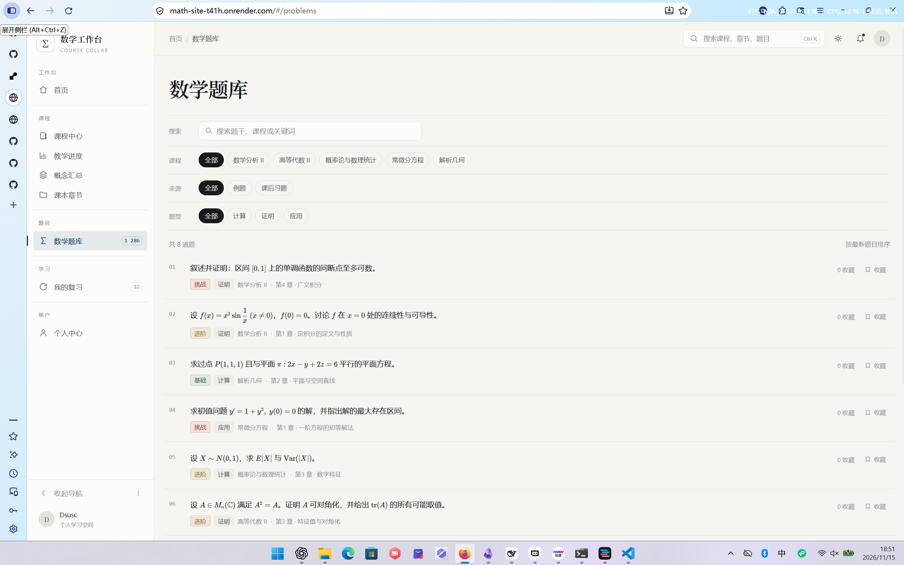
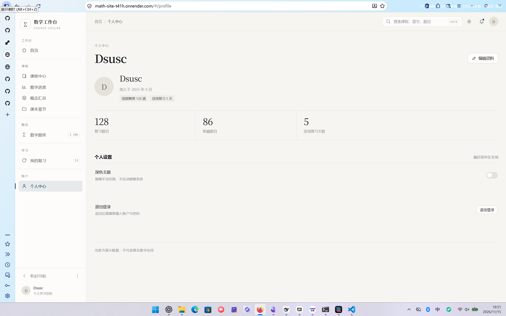

# 数学工作台 · Math Workbench

**个人独立全栈项目 | An Independent Full-Stack Project**

**在线体验**：https://math-site-t41h.onrender.com
**GitHub**：https://github.com/dsusczhaofangfang-bit

Live demo (free instance, first load may take ~30s to wake up) · 免费实例，休眠后首次打开可能需要等待约 30 秒。


面向数学学习的个人知识管理站点：把课程章节、题库、概念、错题与学习时长放在同一个工作台里。

A personal knowledge workspace for learning mathematics — courses, problem bank, concept network, mistake notebook and study time in one place.

<p align="center"><strong>让课程、题目与概念彼此连通。 / Connect courses, problems and concepts.</strong></p>

---

## 01. 项目概述 | Overview

### 中文

数学工作台是一个独立开发的全栈 Web 应用，服务于我自己的数学学习过程。

它解决的具体问题是：课程进度、数学题目、概念定义和错题分散在不同地方，复习时需要在多个工具之间来回切换。工作台把它们整合成一个可互相跳转的系统：

- 课程中心 → 具体课程 → 章节详情 → 本章题目 → 题目详情 → 相关概念，全程可点击跳转
- 题目可以加入错题积累本，错题可以点回原题
- 首页根据「已加入的课程」展示继续学习入口
- 每周学习时长由页面内的计时自动统计，形成学习节奏图

### English

Math Workbench is an independently developed full-stack web application built for my own mathematics study workflow.

It addresses a concrete problem: course progress, problems, concept definitions and mistakes usually live in separate tools, forcing context switching during review. The workbench turns them into one linked system — every course, chapter, problem and concept can be navigated from one another, mistakes are collected and linked back to their source problems, and weekly study time is recorded automatically.

---

## 02. 开发过程 | Development Process

### 中文

项目不是一次性设计完成的，而是分成四个阶段推进，每个阶段都先跑通再进入下一步。

| 阶段 | 做了什么 | 阶段结果 |
|---|---|---|
| 一、静态原型 | 先用原生 HTML/CSS/JS 写出完整页面流程：首页、课程中心、课程详情、题库、题目详情、概念、课本、错题本、教学进度、个人中心。数据写在前端，交互与排版先定型 | 确认信息架构与视觉风格，页面之间可以正常跳转 |
| 二、前端功能补全 | 加入收藏、错题、复习计划、概念跳转、章节跳转、登录页与欢迎页动效；数据暂存浏览器本地 | 交互闭环打通，明确哪些数据真正需要落库 |
| 三、后端与接口化 | 搭建 Node + TypeScript + Fastify 骨架，设计数据库 schema、迁移与种子数据；实现注册登录与 Session 鉴权，然后按模块逐个把前端的本地数据换成接口：题目与收藏 → 错题 → 概念 → 课本章节 → 教学进度 → 课程与章节 | 前后端完全打通，数据持久化 |
| 四、上线与迭代 | 接口统一到 `/api` 前缀、由 Fastify 托管前端；部署到 Render 与 Neon 并配上 HTTPS；上线后修复端口绑定、移动端布局、样式缓存等问题；随后补上学习时长统计与前端模块拆分 | 线上可访问，进入个人内测 |

几个影响后续设计的决定：

- 早期刻意不做教师端与权限系统，只保留「一个人自己的学习数据」，避免为不存在的需求增加复杂度
- 每次只迁移一个模块的数据源，迁移完立刻验证页面，再动下一块
- 结构化数据（课程、章节、题目、概念）优先落库，纯展示文案保留在前端
- 遇到网络不稳时先用 GitHub 网页上传文件抢先发布修复，之后再把本地提交补齐

### English

The project was not designed in one pass. It moved through four stages, each verified before the next one started.

| Stage | What was done | Outcome |
|---|---|---|
| 1. Static prototype | Built the full page flow in vanilla HTML/CSS/JS — home, course centre, course detail, problem bank, problem detail, concepts, textbooks, mistake notebook, teaching progress, profile. Data lived in the frontend while layout and interactions were settled | Information architecture and visual style confirmed |
| 2. Frontend features | Added bookmarks, mistakes, review plan, concept and chapter linking, login page with transition into the app; data temporarily stored in the browser | Interaction loop closed; clarified which data really needed persistence |
| 3. Backend and API migration | Set up a Node + TypeScript + Fastify skeleton, designed schema, migrations and seed data, implemented registration/login with sessions, then replaced local data module by module: problems and bookmarks → mistakes → concepts → textbook chapters → teaching progress → courses and chapters | Frontend and backend fully connected, data persisted |
| 4. Deployment and iteration | Moved APIs under `/api`, let Fastify host the frontend, deployed to Render with Neon over HTTPS, then fixed port binding, mobile layout and style caching issues; later added study-time tracking and split the frontend into modules | Live and in personal closed beta |

Design decisions that shaped the rest of the work:

- Deliberately skipped teacher roles and permission systems; the data belongs to one learner, so complexity was not added for requirements that do not exist
- Migrated one data source at a time and verified the page immediately after each migration
- Moved structured data (courses, chapters, problems, concepts) into the database first; static copy stayed in the frontend
- When the network was unreliable, shipped fixes through GitHub's web upload first and completed the local commits afterwards

---

## 03. 项目背景 | Motivation

### 中文

学习数学时，真正耗时的往往不是做题本身，而是「找东西」：这一章讲了什么、这道题对应哪个概念、上个月错过的题在哪里。

所以这个项目不追求做一个通用的教学管理系统，而是围绕一个人真实的复习路径，把信息组织成可以顺着点下去的链路。

### English

When studying mathematics, the expensive part is rarely solving a problem — it is finding things: what a chapter covers, which concept a problem belongs to, where last month's mistakes went.

The project therefore does not aim to be a general-purpose teaching platform. It organises information around one person's real revision path, so that following links is enough.

---

## 04. 核心模块 | Core Modules

### 中文

| 模块 | 内容 |
|---|---|
| 课程中心 | 课程列表、课程详情、课后作业、最近更新 |
| 课程章节 | 章节详情：小节列表、本章题目、章节说明、相关概念 |
| 数学题库 | 按课程、来源（例题 / 课后习题）、题型筛选，跳题目详情 |
| 题目详情 | 思路提示、参考解答（KaTeX 公式）、相关概念、加入错题本 |
| 概念汇总 | 概念列表与概念详情，题目与章节可跳转至概念 |
| 错题积累本 | 错题列表、按课程分组、点击回到原题 |
| 教学进度 | 每周教学计划，点击周次跳到对应章节 |
| 课本 | 教材目录、章节例题与课后题跳转 |
| 个人中心 | 昵称、学院、密码修改，收藏与错题入口 |
| 学习统计 | 页面内计时上报，按天聚合为本周学习节奏 |

### English

| Module | Content |
|---|---|
| Course Centre | Course list, course detail, homework section, recent updates |
| Course Chapters | Chapter detail: sections, chapter problems, description, related concepts |
| Problem Bank | Filter by course, source (example / exercise) and type; open problem detail |
| Problem Detail | Hints, reference solution (KaTeX), related concepts, add to mistake notebook |
| Concept Library | Concept list and detail; problems and chapters link into concepts |
| Mistake Notebook | Noted mistakes grouped by course, each linking back to its problem |
| Teaching Progress | Weekly plan; clicking a week jumps to the matching chapter |
| Textbooks | Table of contents; examples and exercises jump to problems |
| Profile | Nickname, school, password updates; entry points to bookmarks and mistakes |
| Study Stats | In-page timing reported to the backend, aggregated into a weekly rhythm chart |

---

## 05. 技术架构 | Technical Architecture

### 中文

前端为原生 HTML / CSS / JavaScript，无框架；后端使用 Fastify 同时提供 REST 接口并托管前端静态资源，接口统一挂在 `/api` 前缀下，因此线上同源、不需要跨域。

```
浏览器（原生 HTML/CSS/JS，16 个脚本模块）
        │  fetch /api/*
        ▼
Fastify 5（TypeScript）
├── 认证：邮箱 + 密码，Argon2id 哈希，服务端 Session
├── 业务路由：courses / chapters / problems / concepts
│              textbooks / progress / bookmarks / wrong-items
│              study（学习时长上报与聚合）
├── 静态托管：@fastify/static 输出前端页面
└── 数据层：Drizzle ORM + 迁移脚本 + 种子数据
        │
        ▼
PostgreSQL（线上 Neon） / PGlite（本地文件库）
```

### English

The frontend is framework-free HTML / CSS / JavaScript. The backend uses Fastify both to serve the REST API under `/api` and to host the frontend bundle, so production traffic is same-origin and needs no cross-origin setup.

```
Browser (vanilla HTML/CSS/JS, 16 script modules)
        │  fetch /api/*
        ▼
Fastify 5 (TypeScript)
├── Auth: email + password, Argon2id hashing, server-side sessions
├── Routes: courses / chapters / problems / concepts
│            textbooks / progress / bookmarks / wrong-items
│            study (time reporting and aggregation)
├── Static hosting via @fastify/static
└── Data layer: Drizzle ORM + migrations + seed data
        │
        ▼
PostgreSQL (Neon in production) / PGlite (local file database)
```

---

## 06. 技术栈 | Technology Stack

### 中文

| 分类 | 技术 |
|---|---|
| 前端 | 原生 HTML / CSS / JavaScript（无框架，16 个模块，hash 路由） |
| 公式渲染 | KaTeX（本地化资源） |
| 运行时 | Node.js |
| 语言 | TypeScript |
| 后端框架 | Fastify 5 |
| 数据访问 | Drizzle ORM + drizzle-kit 迁移 |
| 数据库 | PostgreSQL（线上 Neon）/ PGlite（本地） |
| 认证 | Argon2id + 数据库 Session + HttpOnly Cookie |
| 部署 | GitHub + Render（免费实例，自动 HTTPS，提交即部署） |
| 开发工具 | tsx、npm、Git |

### English

| Category | Technology |
|---|---|
| Frontend | Vanilla HTML / CSS / JavaScript (no framework, 16 modules, hash routing) |
| Math rendering | KaTeX (self-hosted assets) |
| Runtime | Node.js |
| Language | TypeScript |
| Framework | Fastify 5 |
| Data access | Drizzle ORM + drizzle-kit migrations |
| Database | PostgreSQL (Neon) / PGlite (local) |
| Auth | Argon2id + database sessions + HttpOnly cookies |
| Deployment | GitHub + Render (free tier, automatic HTTPS, deploy on commit) |
| Tooling | tsx, npm, Git |

---

## 07. 安全与认证 | Security & Authentication

### 中文

- 密码使用 Argon2id 哈希，数据库不保存明文
- 会话记录保存在 `sessions` 表，浏览器只持有 HttpOnly Cookie
- 受保护接口统一经过鉴权前置钩子，未登录返回 401
- 生产环境 Cookie 开启 Secure，仅在 HTTPS 下传输
- 跨域来源、数据库连接串、Cookie 密钥全部通过环境变量配置，不写入代码仓库

### English

- Passwords are hashed with Argon2id; no plaintext is stored
- Sessions live in the `sessions` table; the browser only holds an HttpOnly cookie
- Protected routes share an authentication pre-handler and return 401 when unauthenticated
- Cookies are marked Secure in production and travel over HTTPS only
- Origins, database URL and cookie secret are supplied through environment variables, never committed

---

## 08. 数据库设计 | Database Design

### 中文

目前包含 14 张表，覆盖账号与会话、课程与章节、题目与概念、教材、教学进度和学习时长。

| 分组 | 表 |
|---|---|
| 账号 | users、sessions |
| 课程 | courses、chapters |
| 题库 | problems、bookmarks、wrong_items |
| 概念 | concepts、problem_concepts |
| 教材 | textbooks、textbook_chapters |
| 进度 | progress_tracks、progress_weeks |
| 统计 | study_sessions |

表结构由 Drizzle schema 定义，使用 drizzle-kit 生成并执行迁移，另有可重复运行的种子脚本提供演示数据。

### English

Fourteen tables cover accounts and sessions, courses and chapters, problems and concepts, textbooks, teaching progress and study time.

Schema is defined with Drizzle, migrations are generated and applied through drizzle-kit, and a re-runnable seed script provides demo data.

---

## 09. 我的工作 | Personal Contributions

### 中文

我是这个项目的唯一开发者，独立完成从需求到上线的全部环节：

1. **产品与信息架构**：确定课程、题库、概念、错题、统计五个方向的功能边界，设计「课程 → 章节 → 题目 → 概念」的跳转链路
2. **交互与界面**：配色与排版体系、深浅主题、响应式布局（含移动端适配修复）、滚动与过渡动画
3. **前端实现**：原生 JS 页面与组件、hash 路由、事件委托、状态同步；后期把单文件拆分为 16 个模块
4. **后端与数据库**：Fastify 路由分层、Drizzle schema 与迁移、种子数据、Argon2id 与 Session 鉴权、学习时长聚合接口
5. **部署与运维**：GitHub 仓库、Render Web Service 与 Neon 数据库、环境变量与 HTTPS、线上排障（端口绑定、移动端缓存等）
6. **迭代与验收**：逐条功能确认、线上问题定位与修复

### English

I am the sole developer of this project and handled every stage from requirements to deployment:

1. **Product & information architecture** — defined the scope of courses, problems, concepts, mistakes and study stats, and designed the navigable chain from course to chapter to problem to concept
2. **Interaction & UI** — colour and typography system, light/dark themes, responsive layout (including mobile fixes), scroll and transition animation
3. **Frontend** — vanilla JS views and components, hash router, event delegation, state sync; later refactored a single file into 16 modules
4. **Backend & database** — layered Fastify routes, Drizzle schema and migrations, seed data, Argon2id + session auth, study-time aggregation endpoints
5. **Deployment & operations** — GitHub repository, Render web service, Neon database, environment variables, HTTPS, production troubleshooting
6. **Iteration & validation** — feature-by-feature verification, diagnosing and fixing live issues

---

## 10. 项目展示 | Preview

### 中文

**入口：登录页与欢迎页**

<p align="center">
  
  
</p>

**首页与课程中心**

<p align="center">
  
  
</p>

**数学题库与概念汇总**

<p align="center">
  
  
</p>

**个人中心**

<p align="center">
  
</p>

### English

Screenshots of the working application: sign-in and welcome screens, home with the study-rhythm chart, course centre, problem bank with source filters, concept library, and profile.

---

## 11. 项目进度 | Project Status

### 中文

**当前状态：前后端已完成并部署上线，处于个人内测阶段。**

| 组件 | 状态 |
|---|---|
| 前端页面与交互 | 已完成 |
| 后端接口（认证、课程、题库、概念、教材、进度、收藏、错题、学习统计） | 已完成 |
| 数据库 schema、迁移与种子数据 | 已完成 |
| 线上部署（Render + Neon，HTTPS） | 已完成 |
| 移动端适配 | 已修复主要问题 |
| 在线讨论 / 评论 | 未开始 |
| 题库分页 | 未开始 |
| 接口限流与更细粒度的安全加固 | 未开始 |

### English

**Current status: frontend and backend are complete and deployed; the project is in a personal closed beta.**

| Component | Status |
|---|---|
| Frontend views and interactions | Done |
| Backend APIs (auth, courses, problems, concepts, textbooks, progress, bookmarks, mistakes, study stats) | Done |
| Database schema, migrations and seed data | Done |
| Production deployment (Render + Neon, HTTPS) | Done |
| Mobile adaptation | Main issues fixed |
| Discussion / comments | Not started |
| Problem list pagination | Not started |
| Rate limiting and further hardening | Not started |

---

## 12. 本地运行 | Run Locally

### 中文

```bash
# 后端（同时托管前端页面）
cd backend
npm install
cp .env.example .env      # 填写 DATABASE_URL 与 COOKIE_SECRET
npm run db:migrate
npm run db:seed
npm start                 # 打开 http://localhost:3000
```

未配置 `DATABASE_URL` 时会自动使用本地 PGlite 文件数据库，适合直接试跑。

### English

```bash
cd backend
npm install
cp .env.example .env      # set DATABASE_URL and COOKIE_SECRET
npm run db:migrate
npm run db:seed
npm start                 # http://localhost:3000
```

Without `DATABASE_URL` the app falls back to a local PGlite file database, so it runs out of the box.

---

## 13. 后续规划 | Future Work

### 中文

- 概念之间的关系网络（前置知识、相关概念）
- 题目列表分页与更细的检索
- 在线讨论 / 题解互动
- 接口限流、注册校验与更完整的错误处理
- 绑定自定义域名，替换免费实例以消除冷启动等待

### English

- Concept relationship graph (prerequisites, related concepts)
- Pagination and finer search in the problem bank
- Discussion threads and solution sharing
- Rate limiting, registration validation, fuller error handling
- Custom domain and a paid instance to remove cold starts

---

## 14. 隐私与源码 | Privacy & Source Code

### 中文

本仓库为项目展示用途，源代码私有保存，不通过此仓库分发。需要演示账号或功能预览可与我联系。

### English

This repository serves as a project showcase. The source code is kept private and is not distributed through it. Contact me for a demo account or a walkthrough.

---

## 15. 声明 | Disclaimer

### 中文

本项目为个人独立开发的学习型项目，与任何学校、学院或教师无关，也不属于任何官方系统。

### English

This is an independently developed personal learning project. It is not affiliated with any university, department or instructor, and is not an official system of any institution.

---

**以解决自己的问题为起点，用工程的方式把它做完。**

**Built by solving my own problem, one working feature at a time.**
